# Snaplet 화면 갤러리

Windows CI의 실제 WPF 렌더러에서 합성 데이터로 생성한 화면입니다. 물리 입력·사용자 PC의 캡처 지연을 검증한 화면은 아닙니다. 네이티브 제목 표시줄을 제외한 앱 콘텐츠를 보여 줍니다.

## 시작 화면

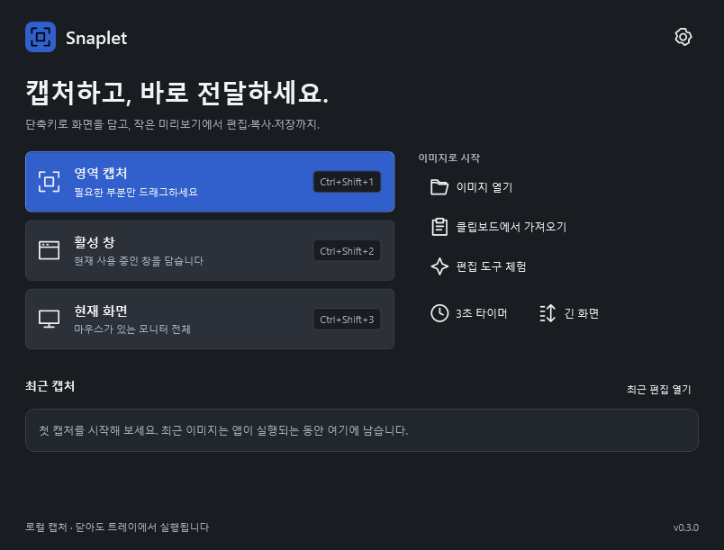

## 설정

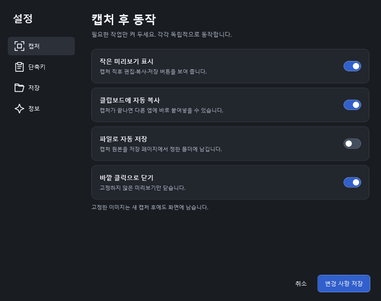

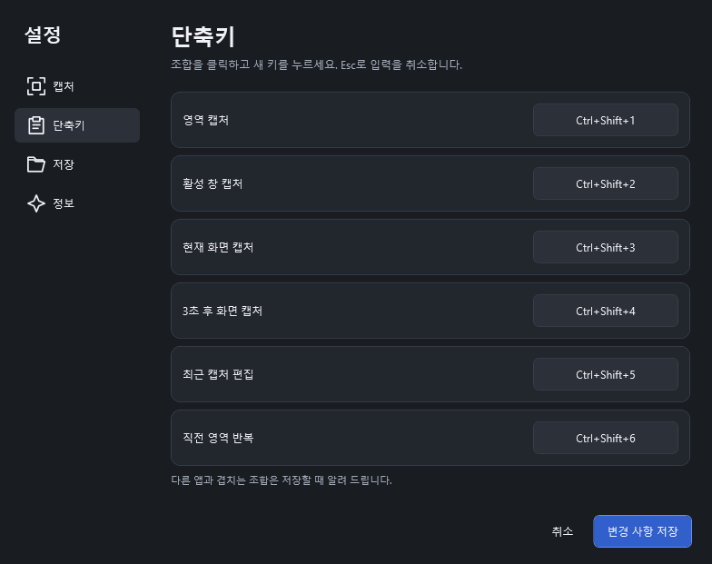

## 작은 미리보기와 고정 이미지

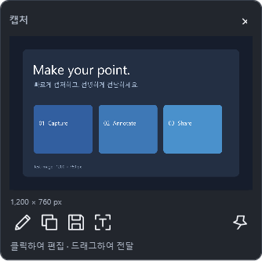

고정 이미지의 도구는 마우스를 올리면 나타납니다.

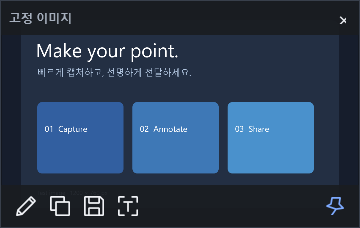

## 편집

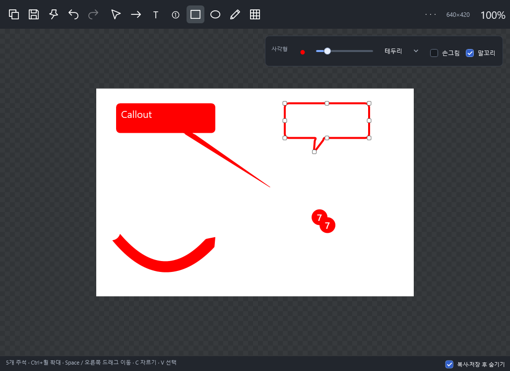

주석의 곡선·끝 마감·도형 스타일 비교판입니다.

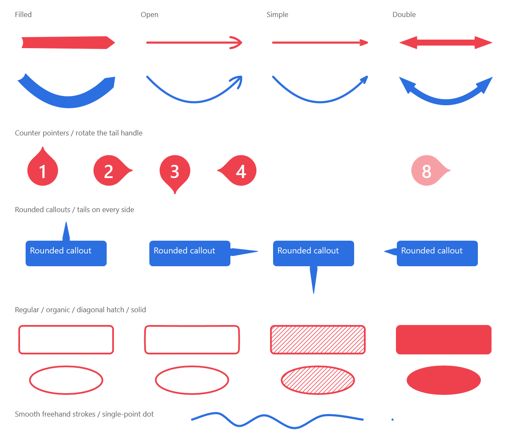

[편집 도구 사용법](editor-tools.ko.md)

도형의 말꼬리 옵션을 켜서 만든 사각형·타원 예시입니다.

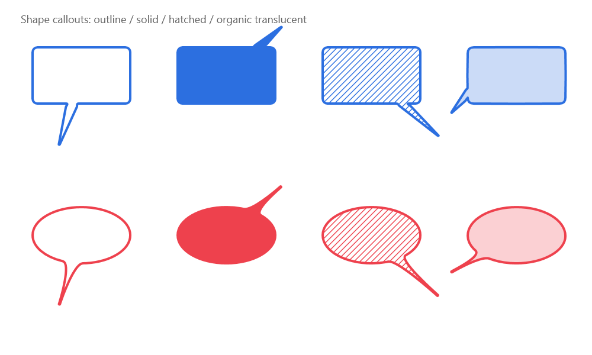

## 추가 편집 도구

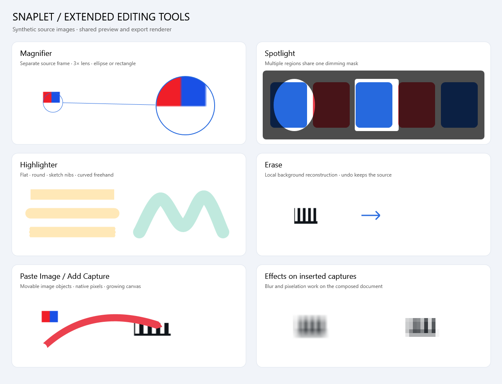

[추가 도구 사용법](advanced-tools.ko.md)

## 텍스트 추출

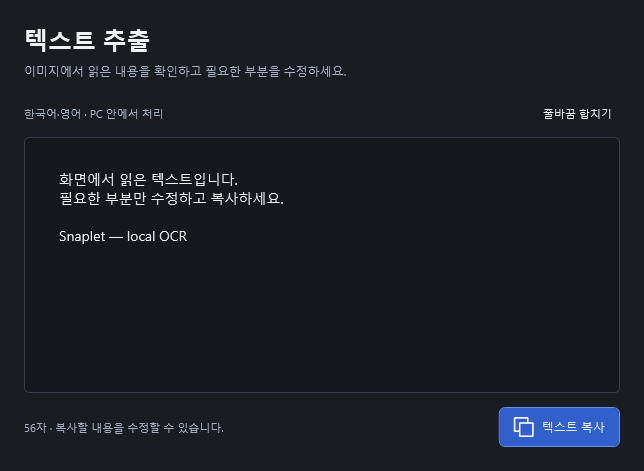

## 긴 화면과 오류 안내

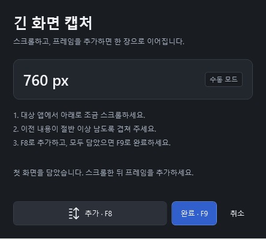

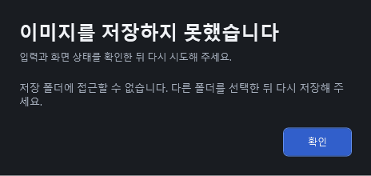

[디자인 기준](design-system.ko.md) · [설치·사용 안내](../README.md)

## v0.6 · 긴 말풍선 입력

실제 Windows WPF 창의 합성 테스트 이미지다. 입력 중에도 색과 둥근 모서리를 유지하고, 입력창과 완료 후의 줄바꿈 폭을 맞췄다. 입력 중에는 이전 객체의 속성 패널을 숨기고 완료 후 복구한다. 실제 한국어 IME 조합을 촬영한 이미지는 아니다.

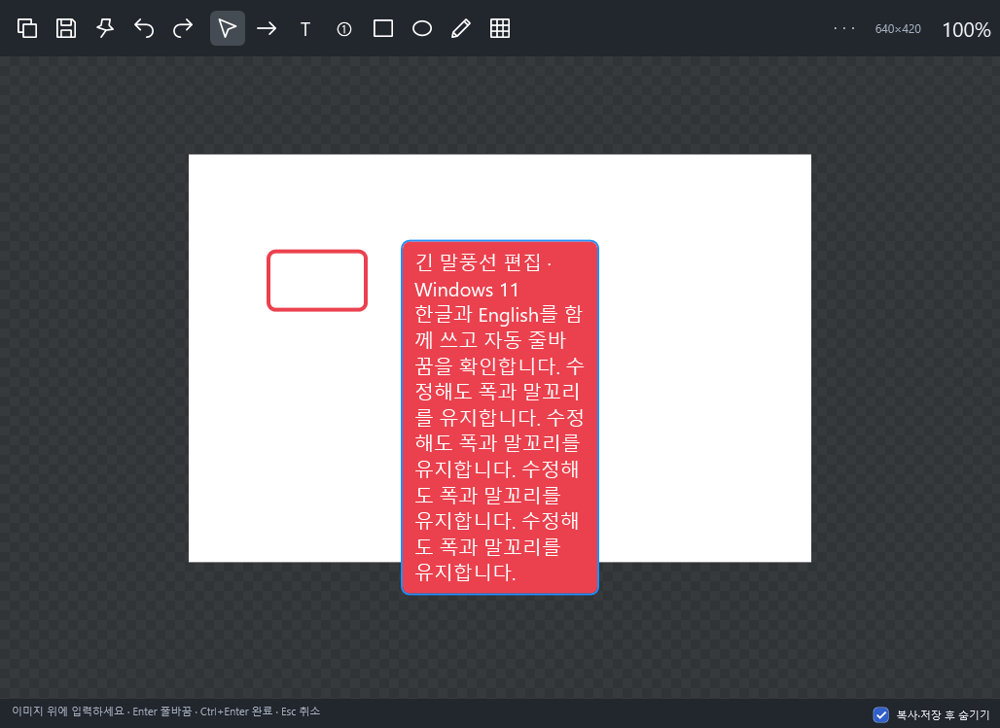
